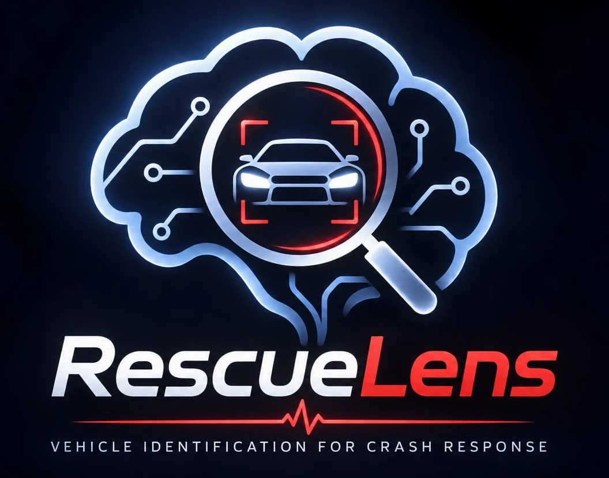
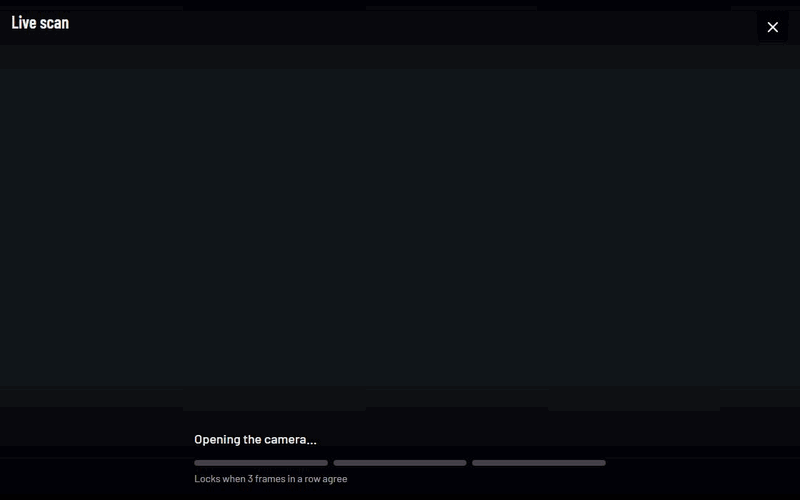
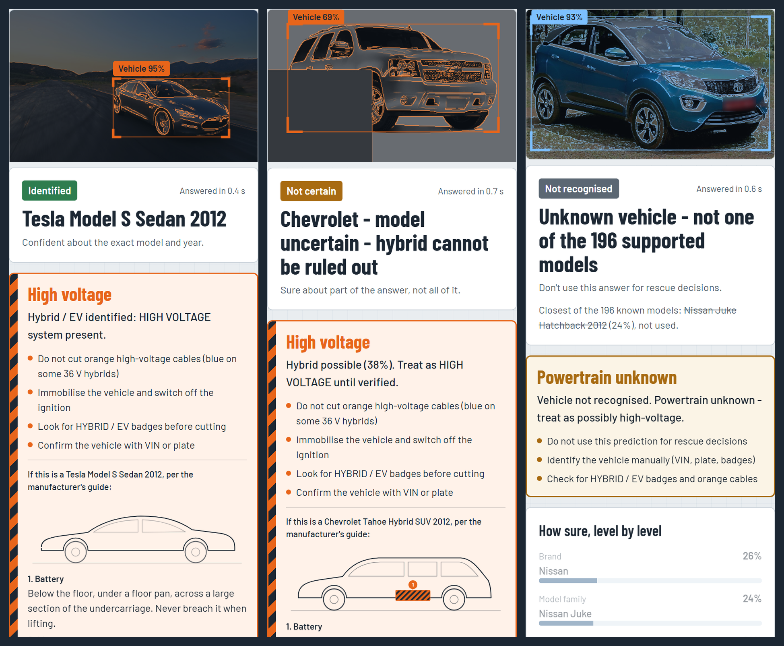
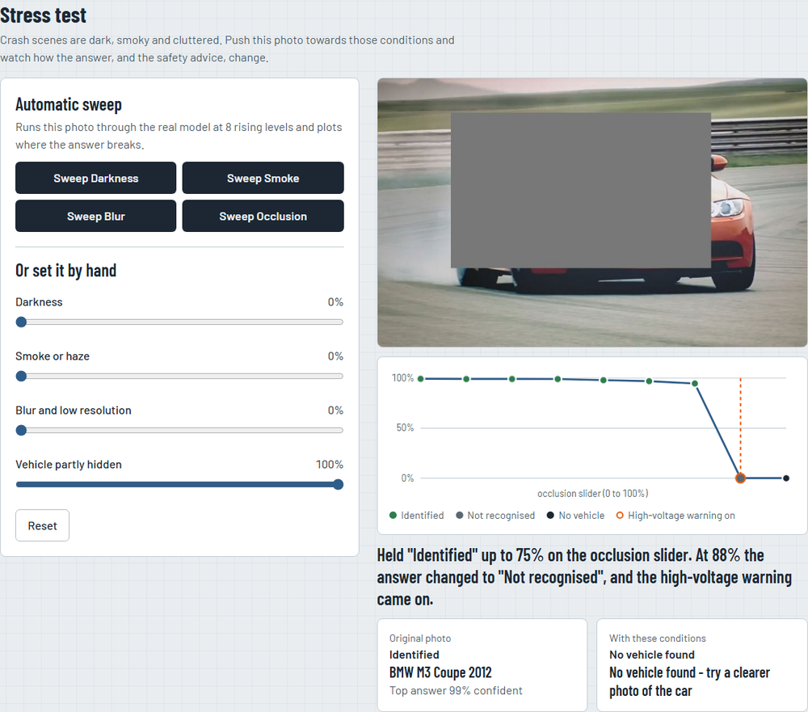
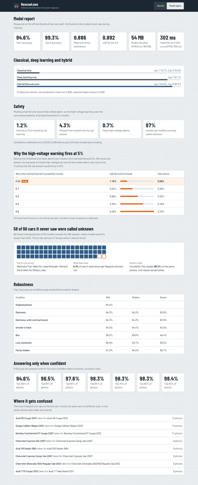
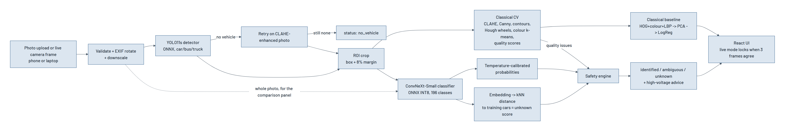

<div align="center">



### Point a phone at a crashed car. Know what it is, where the high voltage runs, and when not to trust the answer.

[](https://priyanshu-senapati--rescuelens-web.us-east.modal.run)
[](https://github.com/Priyanshu-senapati/Rescuelens/actions/workflows/ci.yml)


**Team T50 "Clover"** · Computer Vision Hackathon 2026 · Problem statement P5



<sub>Real answers from the deployed model. The camera feed is simulated from a sample photo.</sub>

</div>

---

## Most classifiers are built to be right. RescueLens is built to know when being wrong is dangerous.

Before cutting a trapped person out of a car, rescuers need to know exactly what they are cutting. Hybrids and EVs hide high-voltage batteries and cables behind bodywork that can look identical to the petrol version. Today's tools need a number plate, VIN or QR code first, and at a crash those can be crushed, hidden or missing.

**India had 4,80,583 road accidents and 1,72,890 deaths in 2023** ([MoRTH](https://data.opencity.in/dataset/road-accidents-in-india-2023)), while yearly EV registrations grew **from 1.74 lakh to 19.68 lakh** between FY 2019-20 and FY 2024-25 ([Lok Sabha, source: Vahan](https://heavyindustries.gov.in/sites/default/files/2026-03/lsauq_2913_0.pdf)). Sources and caveats are in the [design document](docs/design.md).

RescueLens detects the vehicle, names its make, model and year across 196 Stanford Cars classes using a hybrid of classical computer vision and deep learning, and then decides what is safe to conclude.

## One model, three honest answers



| Answer | When | What the responder is told |
|---|---|---|
| **Identified** | Sure of the exact model and year | The vehicle, plus where its battery and cables are if it's a hybrid or EV |
| **Not certain** | Sure of the brand or family only | The part it is sure of. If a hybrid is possible at all, treat it as high voltage |
| **Not recognised** | The car looks unlike anything it trained on | It refuses to guess. Treat as possibly high voltage and identify it by hand |

## What makes it different

| | |
|---|---|
| **Live camera that locks** | A frame every 1.5 s, with a live edge drawing and corner ticks on the vehicle. Three agreeing frames lock the answer |
| **Warnings never wait** | A high-voltage warning shows on the first frame that raises it, and a flickering warning can never lock as safe |
| **Summed-probability safety rule** | No single hybrid has to win. If all 9 hybrid/EV classes together reach 5%, the warning fires |
| **A rescue sheet that draws itself** | Marks where the battery sits and how the cables run, read from [manufacturer guides for all 9 models](docs/hazard-sources.md) |
| **Two experts on the brand** | A second network votes on badge, grille and lights from zoomed windows. Summed brand evidence can overrule a lone top guess |
| **Add another side** | Front crushed? Add up to 3 photos of one vehicle and the evidence combines. Photos that name different brands are never merged |
| **Night second reading** | Dark crops are also read from a contrast-boosted copy and the two are averaged |
| **Automatic stress sweep** | One button runs your photo through the real model at 8 rising levels of darkness, smoke, blur or occlusion, plots the curve and says where the answer broke |
| **It shows its working** | While the model runs, the photo dims into its real edge map. Every classical stage is visible and playable |
| **Three approaches, side by side** | Classical, deep learning and hybrid on the same photo |
| **Works without signal (opt-in)** | An installable app can run the models on the device, under the same safety rules |
| **Fails safely** | A crash shows safe advice and "Start again", never a blank page |



## The numbers

Official Stanford Cars test split: 8,041 images, never used for training or tuning. Full tables: [`eval_P5_T50.md`](eval_P5_T50.md).

| P5 metric | Result |
|---|---|
| **Classification** | Top-1 **94.55%**, top-5 **99.27%** (ConvNeXt-Small, 384 px, on annotated-box crops) |
| **Localization** | Mean IoU **0.954** (fine-tuned YOLO11s; 0.886 before fine-tuning, 0.639 for classical contours) |
| **Detection** | mAP@0.5 **0.999**, mAP@0.5:0.95 **0.941** (0.892 / 0.825 before fine-tuning) |
| **Efficiency** | 189.4 MB -> **54.3 MB** INT8, 739 ms -> **302 ms** on 2 CPU threads, no accuracy loss on a 300-image check |
| **Robustness** | Darkness and haze barely matter (94.40% -> 93.75% / 94.00% at the worst level). Severe blur 40%, very low resolution 53%, heavy occlusion 66% |
| **Confidence** | ECE 0.098 -> **0.011** after temperature scaling. Most confident 90% of photos: 97.58% accurate |

And the ones that go beyond the brief:

| Beyond the brief | Result |
|---|---|
| **Classical vs deep vs hybrid** | 13.7% vs 91.7% vs **94.6%** top-1 |
| **Missed hybrids and EVs** | **1.15%** with the summed rule vs 4.32% trusting the top answer, with 0.69% false alarms |
| **Unseen car models** (30 models, 60 photos) | **96.7%** answered "unknown"; 8.3% of known cars wrongly flagged |
| **Brand accuracy** (49 brands) | **98.61%**, and **92.05%** with 30% of the vehicle hidden |
| **Real crash photos** (48) | Declined to identify **44**; of 3 confident answers, 1 was wrong |

<details>
<summary><b>See the Model report page</b></summary>



</details>

## Try these on the live app

Answers from the real deployed model, 7 Nov 2026. Each takes about 1.2 to 1.8 seconds.

| Sample | Answer | Why it's worth showing |
|---|---|---|
| Clear daylight photo | **Identified:** BMW M3 Coupe 2012, 99% | Press **Sweep occlusion**: it holds, then flips to "Not recognised" and the warning comes on |
| Hybrid that looks like a petrol car | **Identified:** Hyundai Sonata Hybrid 2012, 99%, high voltage | The whole pitch in one photo |
| Taken at night | **Identified:** Audi S4 Sedan 2012, 90% | Darkness barely hurts accuracy |
| Partly hidden | **Identified:** Chevrolet Tahoe Hybrid 2012, 69%, high voltage | Still finds the hybrid with part of it covered |
| Hybrid or not? Rear hidden | **Not certain:** Chevrolet Silverado family, hybrid can't be ruled out | Uncertainty changes the advice |
| Electric car | **Identified:** Tesla Model S 2012, 99%, high voltage | Finds the EV and warns about it |
| Look-alike trim: S5 or A5? | **Not certain:** Audi, model uncertain | Its most frequent mix-up, and it says so |
| Indian car outside the 196 models | **Not recognised** | Refuses to guess at a Tata Nexon |

## Everything P5 asks for, and where to find it

<details open>
<summary><b>Mandatory technical components</b></summary>

| Requirement | How | Where |
|---|---|---|
| Preprocessing and normalization | EXIF rotate, downscale, CLAHE, resize, ImageNet normalization | `backend/app/main.py`, `classical.py`, `models.py` |
| Edge detection and contours | Canny, largest contour, body outline | `backend/app/classical.py` |
| Colour and texture features | HSV histogram, colour k-means, LBP | `backend/app/classical.py` |
| Region of interest | Detector box + 8% margin, same rule as training | `classical.crop` |
| Geometric features | Aspect ratio, Hough wheels, wheelbase ratio | `backend/app/classical.py` |
| CNN fine-grained classifier | ConvNeXt-Small at 384 px, 196 classes | `training/train_classifier.py` |
| YOLO vehicle detection | YOLO11s fine-tuned on the Stanford train boxes | `training/finetune_detector.py` |
| Transfer learning and fine-tuning | ImageNet-22k and COCO pretrained, then fine-tuned | `training/` |
| Hybrid integration | Detector crops feed the classifier; classical quality checks explain the confidence and CLAHE retries detection | `backend/app/pipeline.py` |
| Boxes, labels, confidence | Drawn on the photo, with confidence by brand, family and model | `frontend/src/components/` |
| Low-confidence handling | Identified, not certain or not recognised, with unknown-car detection | `backend/app/safety.py` |

</details>

<details>
<summary><b>Advanced requirements</b></summary>

| Requirement | Evidence |
|---|---|
| Visually similar makes, models and years | Brand-first decision, family-level answers, most-confused table |
| Illumination and viewing angles | Darkness and haze robustness table, night second reading, multi-photo answers |
| Occlusion and resolution | Occlusion and low-resolution robustness tables, automatic sweep |
| Classical vs deep vs hybrid | Comparison table in the eval file, and live on every photo |
| Ablation | Removes the fusion and crop, adds TTA, swaps INT8 for FP32 (eval file) |
| Model optimization | Dynamic INT8 quantization, 3.5x smaller and 2.4x faster |
| Unseen test images | Official test split, 60 unseen-model photos, 48 real crash photos |
| At least 3 failure cases | 8 explained in [design document section 9](docs/design.md), with screenshots |

</details>

<details>
<summary><b>Deliverables</b></summary>

| Deliverable | Where |
|---|---|
| Live URL | [priyanshu-senapati--rescuelens-web.us-east.modal.run](https://priyanshu-senapati--rescuelens-web.us-east.modal.run) |
| Source code | This repository |
| Architecture diagram | Below, and [`docs/architecture.png`](docs/architecture.png) |
| Design document | [`docs/design.md`](docs/design.md) |
| Comparative evaluation | [`eval_P5_T50.md`](eval_P5_T50.md) |
| Ablation and failure cases | [`eval_P5_T50.md`](eval_P5_T50.md), [design document section 9](docs/design.md) |

</details>

## How it works

<div align="center">

</div>

Reasoning behind each choice: [design document](docs/design.md).

## Run it

```bash
docker build -t rescuelens --build-arg MODEL_BASE_URL=<folder-with-the-model-files> .
docker run -p 7860:7860 rescuelens          # open http://localhost:7860
```

The model weights aren't in git (GitHub's 100 MB limit), so `MODEL_BASE_URL` must point at a folder holding them. Without them the app still runs, but serves **sample answers** and says so on screen. Use the [live app](https://priyanshu-senapati--rescuelens-web.us-east.modal.run) for real answers.

For UI work with no back end:

```bash
cd frontend && npm ci && VITE_MOCK=1 npm run dev
```

The live deployment runs on Modal: `modal deploy modal_app.py`. The camera needs https or localhost.

### Tests

```bash
cd backend && pip install -r requirements.txt -r requirements-dev.txt && pytest
```

```bash
cd frontend && npm ci && npx playwright install chromium && npm test
```

CI runs both on every push. Check the demo samples against the real models with `python tools/check_samples.py`.

### Reproduce the numbers

1. Get Stanford Cars with test labels (e.g. Kaggle `jutrera/stanford-car-dataset-by-classes-folder`) and extract it.
2. Python 3.11 + CUDA PyTorch, then `pip install timm onnx onnxruntime onnxscript scikit-learn scipy "opencv-python-headless<5" pillow ultralytics`.
3. From the repo root, with `DATA_ROOT` set to the extracted folder, `EXPORT_DIR=models` and `QUICK=0`:
   - `python training/train_classifier.py` (about 45 min on an RTX 5070 Ti laptop GPU, 2.5 h on a Kaggle T4)
   - `python training/finetune_detector.py`
   - `python training/detector_and_baseline.py` with `YOLO_WEIGHTS=models/yolo11s_cars.pt`, for the detector and classical numbers
   - `python training/train_brand_parts.py`, for the close-up brand expert

   On Windows, `training\run_local.ps1` starts them as background processes.
4. `python tools/eval_unknown.py <unseen-car-photos>` and `python tools/eval_crashed.py <crash-photos>`. These photos aren't in git because they aren't ours to redistribute.
5. `python tools/build_report.py --train models --det models --team T50 --usns "..."` writes `eval_P5_T50.md`.

Seed 42 everywhere; the validation split is a stratified 10% of the official train split.

## Find your way around

| Folder | What |
|---|---|
| `training/` | Training scripts: classifier, detector fine-tuning, classical baseline, brand expert |
| `backend/` | FastAPI inference service (ONNX Runtime) and the safety engine |
| `frontend/` | React UI: live camera, results, stress test, Model report, offline mode |
| `data/` | Class names, hybrid/EV guides and locations, measured safety numbers |
| `tools/` | Report builder, unknown-car and crash evaluations, sample checker |
| `docs/` | Design, API, sources, viva sheets, field kit |

**Docs:** [Solution report](docs/Solution_Report_P5_T50.md) · [Design](docs/design.md) · [API contract](docs/api-contract.md) · [High-voltage sources](docs/hazard-sources.md) · [Build plan](docs/BUILD_PLAN.md) · [Field kit](docs/field-kit.md) · [Viva sheets](docs/viva/) · [Evaluation](eval_P5_T50.md) · [Photo credits](frontend/public/samples/CREDITS.md)

## What it can't do

- It was trained on **US-market cars up to 2012**, so most cars on Indian roads today will be answered "unknown", on purpose. It doesn't recognise them.
- **Close look-alikes can still fool it.** On 8 new photos of a Mahindra Thar, 5 were confidently called a Jeep Wrangler, with no high-voltage warning. That's why the app always says to confirm with VIN or plate.
- There are **no crashed vehicles in the training data**. On 48 real crash photos it got the brand right only 23% of the time, and mostly declined to answer, which is what it should do.
- **94.55% uses the dataset's annotated boxes.** It hasn't yet been re-measured through the real detector, though 99.85% of detector boxes reach IoU 0.5 or above.
- **Weak spots:** severe blur (40% top-1), very low resolution (53%) and heavy occlusion (66%).
- **Offline mode has not been measured** with the real models on a phone.
- **No responder has reviewed the high-voltage text yet.**

> **Decision-support prototype.** Vehicle identification is probabilistic. Never rely on it alone for cutting, lifting or disabling a vehicle. It reads no number plates or faces, and uploads are processed in memory and not kept.

## Team T50 "Clover"

Priyanshu Kumar Senapati · Saatwik Kumar Yadav · Rachana Bhaskar Gowda · R Muni Disnitha
