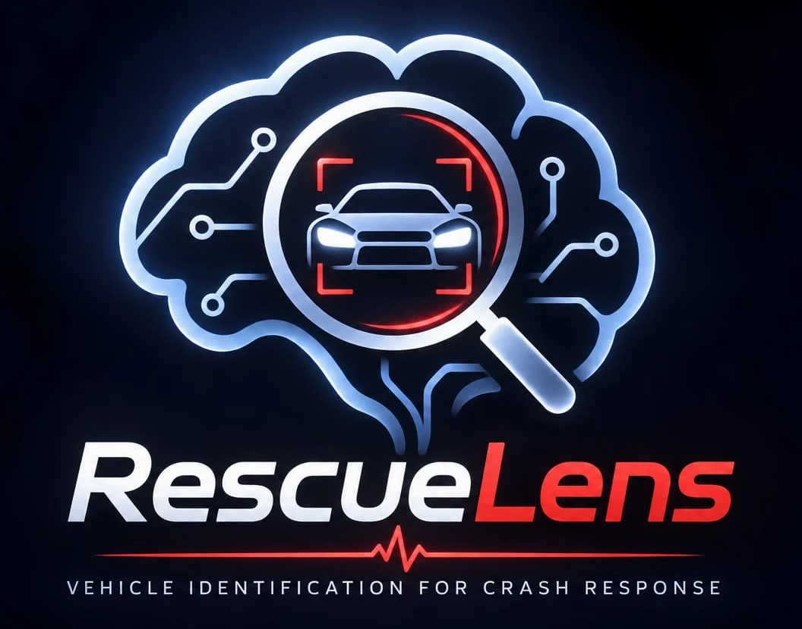
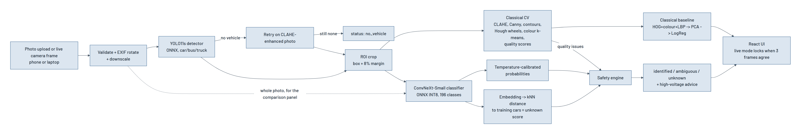
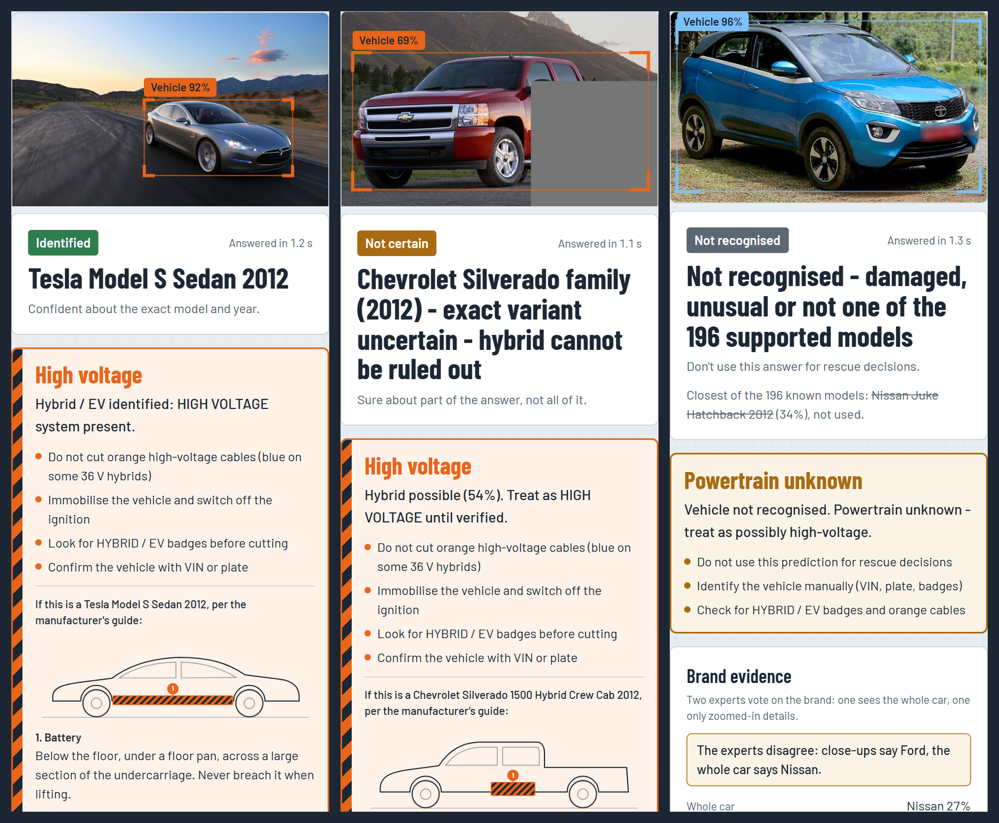
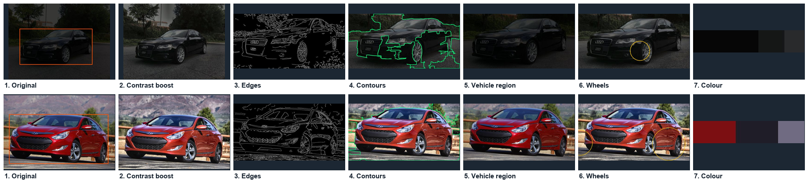
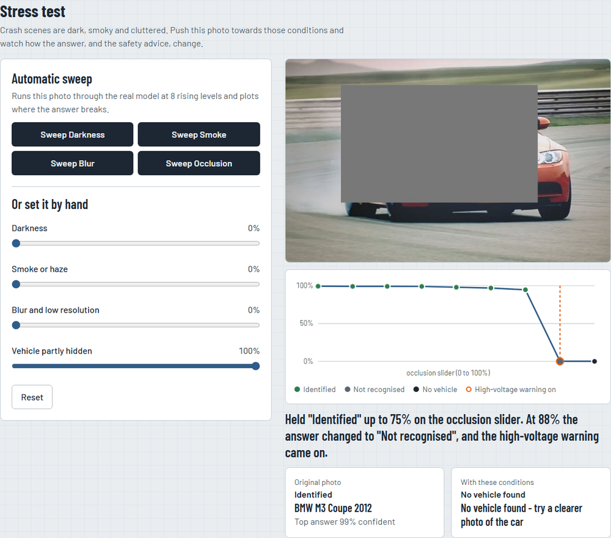
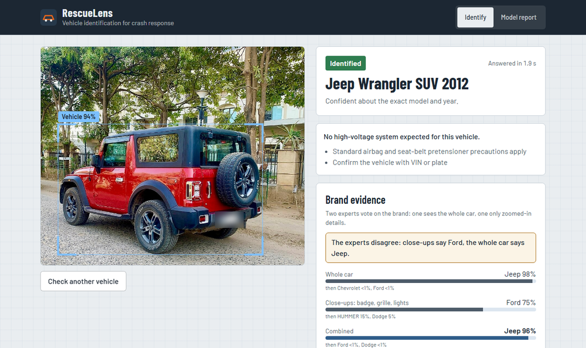

<p align="center"></p>

# Hackathon Technical Solution Report

| Field | Details |
| :--- | :--- |
| **Problem ID** | P5 |
| **Problem Title** | Intelligent Fine-Grained Vehicle Recognition and Analysis System |
| **Team Name** | T50 "Clover" |
| **Team Members** | Priyanshu Kumar Senapati (1RUA24CSE0337), Saatwik Kumar Yadav (1RUA24CSE0390), Rachana Bhaskar Gowda (1RUA24CSE0348), R Muni Disnitha (1RUA24CSE0345) |
| **GitHub Repository** | https://github.com/Priyanshu-senapati/Rescuelens (results checked at commit `04392e7`) |
| **Live Demo / Deployment** | https://priyanshu-senapati--rescuelens-web.us-east.modal.run |

---

## 1. Problem Understanding & Solution Strategy

**Core Technical Challenge:** Stanford Cars asks for one label out of 196, and many of those labels are nearly the same car. An Audi S5 and an Audi A5 differ mainly in the grille, bumpers and badges, and that pair was our most frequent test error (15 photos). A Hyundai Sonata and a Sonata Hybrid share a body. Real photos then add darkness, smoke, blur, low resolution, occlusion and awkward angles on top.

We applied the problem to crash response, where a wrong answer has a cost. Rescuers need to know the model before cutting, because hybrids and EVs carry high-voltage batteries and cables that can't be seen from outside. At a crash the number plate or VIN may be crushed or hidden. That gave us two failure modes to design against: missing a hybrid, and confidently naming a car the model has never seen, which is likely here because the dataset stops at 2012 and covers US-market cars. Our constraints were a public web app usable from a phone, an answer well inside the 10 seconds the rubric allows, and a CPU-only host with 2 cores and 2 GB of memory.

**Proposed Methodology:** A fine-tuned YOLO11s finds the vehicle, classical computer vision measures whether the photo can be trusted, and a ConvNeXt-Small classifies the crop. A safety layer then turns the calibrated probabilities into one of three answers (identified, not certain, not recognised), and warns about high voltage whenever the summed probability of the 9 hybrid and EV classes reaches 5%. We chose this over static baselines because the numbers left little choice: classical features alone reached 13.72% top-1, the network on the whole photo reached 91.66%, and trusting only the top answer missed 4.32% of hybrids and EVs against 1.15% with the summed rule.

---

## 2. Technical Architecture & Implementation



The code is split by job: `backend/app/classical.py` (classical CV), `models.py` (ONNX models), `safety.py` (decision rules), `pipeline.py` (orchestration) and `main.py` (API and input validation). Training lives in `training/`, the React interface in `frontend/`. The design document (`docs/design.md`) has the full reasoning.

### 2.1 Classical Algorithmic Baseline

**Algorithms Utilized:**

| P5 requirement | What we used |
| :--- | :--- |
| Preprocessing and normalization | EXIF rotation, downscaling to 1600 px, CLAHE on the LAB lightness channel, ImageNet normalization |
| Edges and contours | Bilateral filter, Canny, morphological closing, largest outer contour as the body outline |
| Colour and texture | HSV histogram, k-means dominant colours on the central 70% of the crop, 8-neighbour LBP histogram |
| Region of interest | Detector box plus an 8% margin, the same rule used in training |
| Geometry | Aspect ratio, contour extent and solidity, Hough circles for wheels and a wheelbase ratio |

For the required comparison we also trained a classical-only classifier: HOG, HSV colour, LBP and aspect ratio, reduced with PCA and passed to logistic regression. It reached 13.72% top-1 and 34.03% top-5, and the same feature code runs in the app.

**Adaptive Selection Logic:** Canny thresholds come from the photo itself, at 0.66 and 1.33 times the median grey level, so we don't tune them per image. The Hough search is scaled to the car: it looks only in the lower 60% of the crop, for radii between 8% and 30% of the crop height. The CLAHE settings are fixed (clip limit 2.0, 8x8 grid), but when CLAHE runs depends on the input. It retries detection if the first pass finds nothing, and it gives the classifier a second reading when the crop's brightness falls below 30 out of 100. Quality checks on brightness, contrast, Laplacian sharpness, resolution and cut-off produce plain reasons such as "Low light" or "Blurry", which appear beside the answer.

### 2.2 Deep Learning Pipeline

**Model Architecture:**

| Model | Role | Why |
| :--- | :--- | :--- |
| ConvNeXt-Small, 384 px, 49.6 M parameters | 196-class classifier | ImageNet-22k weights transfer well to fine-grained work. We trained ConvNeXt-Tiny first, then moved up: validation top-1 went from 93.74% to 94.23%, and unseen cars caught went from 88.3% to 96.7% |
| YOLO11s, 640 px | Vehicle detector | Started from COCO weights and fine-tuned for 20 epochs on the Stanford train boxes as a single class. Mean IoU went from 0.886 to 0.954 |
| ConvNeXt-Tiny, 224 px windows | Close-up brand expert | Badges are a few pixels wide in a 384 px view of a whole car. This model votes on 49 brands over 9 zoomed windows |

**Loss Functions & Training:** The classifier uses cross-entropy with label smoothing of 0.1 and AdamW (learning rate 2e-4, weight decay 0.05), with a one-epoch warm-up and then a cosine decay, mixed precision and stochastic depth of 0.1. Augmentation covers random resized crops, flips, colour jitter, random darkening to mimic night and random erasing to mimic occlusion. We split the official training images 90/10 with stratification and seed 42, kept the best validation epoch, and touched the 8,041 test images only for final numbers. The brand expert uses the same loss with AdamW, and the detector uses the default Ultralytics training losses. Temperature scaling, fitted on validation, then brought calibration error (ECE) from 0.098 down to 0.011 at T = 0.768.

For deployment we export to ONNX and apply dynamic INT8 quantization to the MatMul and Gemm layers. ConvNeXt's heavy layers are linear, and ONNX Runtime's CPU provider lacks ConvInteger support for int8.

### 2.3 Hybrid Integration & Adaptive Mechanism

**Fusion Strategy:** Classical and deep methods meet at several points. Detection decides the crop the classifier sees. CLAHE rescues detection in dark scenes and supplies a second reading on dark crops, averaged with the first. Quality measurements explain low confidence to the user. We also tried late fusion of classical and deep probabilities, and the best weight on validation came out as 0. The classical model added nothing the network lacked, so we report that and leave it out of classification. The brand expert is fused with the whole-car brand totals by a product rule (whole^0.8 x close-ups^0.2), with the rule and weight chosen on validation. A user can also add up to 3 photos of one vehicle. Their probabilities are multiplied, and photos that confidently name different brands are never merged.

**Decision Logic:** The template's example is about balancing amplification against noise. In our problem the same question is how much to conclude from uncertain evidence.

1. The brand with the most summed probability wins, then the strongest family inside it, then the likeliest model. A lone top guess can't overrule the combined evidence for another brand.
2. The answer stops at the deepest level it is sure of: a model at 0.6 or above, then a family at 0.6 or above, and otherwise the brand alone.
3. A car is called unknown when its brand probability is below 0.5, or when its embedding is far from the training cars. That distance is 1 minus the mean cosine similarity to the 5 nearest training embeddings, with the threshold set at the 95th percentile of validation scores (0.369).
4. The high-voltage warning uses summed probability with a threshold of 0.05. We chose the lowest threshold we tested, because a missed high-voltage car can kill and a false alarm only costs time. Unknown cars are treated as possibly high voltage.

When a hybrid or EV is likely, the app shows where its battery and cables are, taken from the manufacturer's guide for all 9 models, with sources in `docs/hazard-sources.md`.

---

## 3. Experimental Benchmarks & Evaluation

All numbers come from `eval_P5_T50.md` unless we say otherwise. The template's PSNR, SSIM and LPIPS columns measure image enhancement and don't apply to P5, so we report the metrics P5 asks for.

### 3.1 Quantitative Benchmarks

| Approach / Model Variant | Top-1 ↑ | Top-5 ↑ | Finding the vehicle (mean IoU) ↑ | Latency |
| :--- | :---: | :---: | :---: | :---: |
| **Classical Baseline** | 13.72% | 34.03% | 0.639 (edge contours) | Not timed separately |
| **Deep Learning Only** (whole photo) | 91.66% | Not measured | No localization | 302 ms for the classifier |
| **Proposed Hybrid System** | 94.55% | 99.27% | 0.954 | 1.2 to 1.8 s for a full answer on the live site |

| P5 metric | Result |
| :--- | :--- |
| Classification | Top-1 94.55%, top-5 99.27%, 94.70% with flip TTA |
| Object localization | Mean IoU 0.954, with 99.85% of boxes at IoU 0.5 or above (COCO weights: 0.886 and 92.81%) |
| Object detection | mAP@0.5 0.999, mAP@0.5:0.95 0.941 (COCO weights: 0.892 and 0.825) |
| Model efficiency | Classifier 189.4 MB to 54.3 MB, 739 ms to 302 ms on 2 CPU threads, accuracy unchanged at 93.67% on a 300-image check |
| Robustness | See the table below |
| Confidence | Most confident 90% of photos: 97.58% accurate. Most confident 50%: 98.38% |

| Condition (2,000 test photos) | Mild | Medium | Severe |
| :--- | :---: | :---: | :---: |
| Darkness | 94.30% | 94.30% | 93.75% |
| Smoke or haze | 94.45% | 94.40% | 94.00% |
| Blur | 90.55% | 69.05% | 40.40% |
| Low resolution | 90.80% | 83.10% | 52.60% |
| Occlusion | 91.25% | 84.05% | 66.10% |

The rest of our safety evidence goes beyond what P5 requires:

| Test | Result |
| :--- | :--- |
| Missed hybrids and EVs (347 test photos) | 1.15% with the summed rule, 4.32% trusting the top answer, 0.69% false alarms |
| Cars outside the 196 classes (60 photos, 30 models) | 96.67% answered unknown, while 8.33% of known cars were wrongly flagged |
| Brand accuracy, 49 brands | 98.61% on clean photos, 92.05% with 30% of the vehicle hidden |
| Real crash photos (48) | 44 declined. Of 3 confident answers, 1 was wrong |

* **Analysis:** The crop gave the largest accuracy gain, and quantization gave the largest speed gain at no measured accuracy cost on our 300-image check. Darkness and haze barely hurt because training already darkens images, while blur and low resolution remove the fine detail this task depends on. The summed rule trades a small rise in false alarms for far fewer missed hybrids, a trade we'd make every time in this setting. The extra models cost time: a full answer on the live site went from under a second to about 1.3 s as the later models shipped, still well inside the 10-second limit.

**How to read 94.55%:** It was measured on crops from the dataset's annotated boxes, with the classifier alone. It doesn't include errors from our detector, or the brand expert and night reading added later, which we tested separately. With 99.85% of detector boxes at IoU 0.5 or above we'd expect the full pipeline to be close, but we haven't measured that number. The robustness and high-voltage figures above have the same limit.

### 3.2 Visual Outputs & Intermediate Representations

**Three answers from the real model:** a Tesla Model S identified with its battery location, a Chevrolet Silverado with its rear hidden answered as "not certain", and a Tata Nexon, which isn't in the dataset, answered as "not recognised".



**Intermediate stages:** every classical step is returned as an image and shown in the app, as P5 requires. The top row is a dark photo, where the contrast boost in step 2 shows the most. The bottom row is the Sonata Hybrid.



**Stress sweep:** the app runs a photo through the real model at 8 rising levels of one condition and marks where the answer changes. This BMW holds "Identified" up to 75% on the occlusion slider, then turns to "Not recognised" with the warning on.



### 3.3 Ablation Study

| Variant | Top-1 | What it shows |
| :--- | :---: | :--- |
| Full system | 94.55% | Reference |
| Without classical fusion | 94.55% | No change. The fusion weight was 0 on validation |
| Without the crop (whole photo) | 91.66% | The crop adds 2.89 points, the biggest single gain |
| With flip TTA | 94.70% | Adds 0.15 points for double the inference time, so we left it out |
| FP32 instead of INT8 (300 images) | 93.67% vs 93.67% | Quantization lost nothing on this subset |
| CLAHE before the classifier, severe darkness | 93.75% to 93.90% | Very little, because training already darkens images |

Beyond top-1, fine-tuning the detector raised mean IoU from 0.886 to 0.954, and the brand expert raised brand accuracy from 98.30% to 98.61% on clean photos and from 90.75% to 92.05% with 30% hidden. The night reading was neutral to +0.5 points on artificially darkened photos.

---

## 4. Failure Modes & Limitations

| Observed failure | Root cause | Mitigation |
| :--- | :--- | :--- |
| **Mahindra Thar called a Jeep Wrangler.** On 8 new photos on the live model, 5 came back "Identified" at 65 to 99% with no high-voltage warning. The other 3 were answered unknown | The Thar is styled like the Wrangler, so its embedding sits close to a known class and passes the distance check. This is our most serious failure | The app always says to confirm with VIN or plate. Next steps: lower the answer when the brand experts disagree (they did on the photo we inspected), and add look-alikes to a held-out test set when tuning the threshold |
| **Audi S5 taken for Audi A5** (15 test photos), Dodge Caliber 2012 for 2007 (13) | Trims and facelifts change only grilles, bumpers and badges, which are tiny at 384 px | Family-level answers when the year can't be separated, plus the close-up brand expert |
| **Tahoe Hybrid with its upper rear hidden taken for an Avalanche** at 98%, with no warning | The two share a front end, and the detector's box stops at the occluder. With the front hidden instead, the same SUV is still found as the Tahoe Hybrid | The multi-photo option lets a rescuer add another side |
| **Heavy blur:** top-1 falls to 40.40% at the worst level | Blur removes the high-frequency detail that separates similar cars | Quality checks flag "Blurry", so the low confidence comes with a reason |
| **Real crash photos:** brand right only 22.92% of the time on 48 photos | Wrecks and unseen models are far from the training data. Our best answer here is to decline, which it did for 44, but it also made 1 confident wrong call (a wrecked Ford called a Chevrolet) | Collect labelled damaged vehicles, which Stanford Cars doesn't have |



<sub>Photo: Mahindra Thar SUV in "Red Rage" colour, by Ank Kumar, CC BY-SA 4.0, Wikimedia Commons. Plate blurred.</sub>

**Other limits:** The training data is US-market cars up to 2012, so most cars on Indian roads today should be answered "unknown". Robustness tests use simulated degradation. Offline mode has only run with stand-in models, so it's switched off on the live site and we make no accuracy claim for it. Seven of the nine guide links are copies hosted by fire services, a rescue-training site or a rescue-software vendor, since we couldn't reach the manufacturers' own copies. No responder has reviewed the safety text yet.

**Ethics:** This is a decision-support prototype and every answer says so. Unknown cars default to "treat as high voltage". Uploads are processed in memory and not kept, and the system reads no plates or faces. Fine-grained recognition could support surveillance, so we left out plate reading and tracking and kept the scope to rescue.

---

## 5. Deployment & Quickstart Guide

### Quickstart Commands

```bash
# 1. Clone the repository
git clone https://github.com/Priyanshu-senapati/Rescuelens
cd Rescuelens

# 2. Build and run (MODEL_BASE_URL is a folder holding the model files)
docker build -t rescuelens --build-arg MODEL_BASE_URL=<folder-with-the-model-files> .
docker run -p 7860:7860 rescuelens     # open http://localhost:7860

# 3. Run the tests
cd backend && pip install -r requirements.txt -r requirements-dev.txt && pytest
cd ../frontend && npm ci && npx playwright install chromium && npm test

# 4. Run inference on the demo samples (needs the models in ./models)
cd .. && python tools/check_samples.py
```

Model weights aren't in git because of GitHub's file size limit. Without them the app still runs but serves sample answers and says so on screen, so real answers need the live URL or the model files. `README.md` lists the steps to retrain the models and regenerate the evaluation file.

### Deployment Format

One container runs the React interface, a FastAPI service and ONNX Runtime. It's deployed on Modal with one warm container (2 CPUs, 2 GB) from `modal_app.py`, and a `Dockerfile` runs the same app elsewhere. GitHub Actions runs the back-end tests, type check, build and browser tests on every push. The API rejects files that aren't images and photos over 10 MB with a readable message.

### References

* J. Krause, M. Stark, J. Deng, L. Fei-Fei, "3D Object Representations for Fine-Grained Categorization", ICCV Workshops 2013 (Stanford Cars).
* Manufacturer guides for the 9 hybrid and EV models: `docs/hazard-sources.md`.

---

### Student Submission Checklist

- [x] Working GitHub repository link included with an updated `README.md`.
- [x] No raw code pasted into this report.
- [x] All table metrics match test runs reproducible via the repository.
- [x] All team member details accurately recorded.
