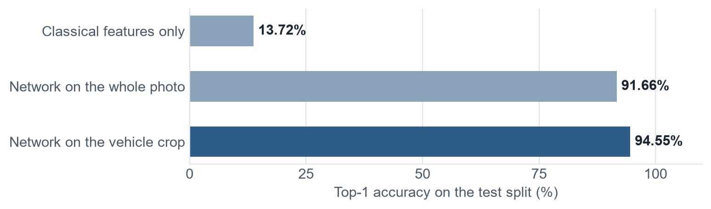
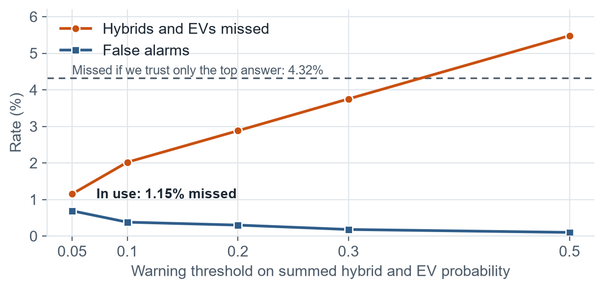
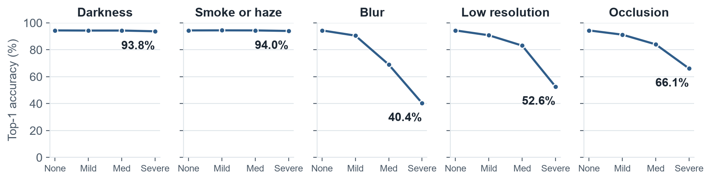
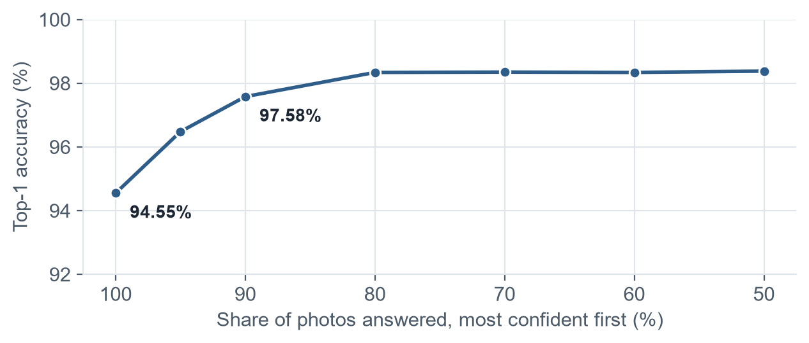

<p align="center"></p>

# Hackathon Technical Solution Report

| Field | Details |
| :--- | :--- |
| **Problem ID** | P5 |
| **Problem Title** | Intelligent Fine-Grained Vehicle Recognition and Analysis System |
| **Team Name** | T50 "Clover" |
| **Team Members** | Priyanshu Kumar Senapati (1RUA24CSE0337), Saatwik Kumar Yadav (1RUA24CSE0390), Rachana Bhaskar Gowda (1RUA24CSE0348), R Muni Disnitha (1RUA24CSE0345) |
| **GitHub Repository** | https://github.com/Priyanshu-senapati/Rescuelens (commit [WRITE: final commit hash]) |
| **Live Demo / Deployment** | https://priyanshu-senapati--rescuelens-web.us-east.modal.run |

---

## AI Assistance Declaration

| Tool | Used by | Used for |
| :--- | :--- | :--- |
| Claude Code (Anthropic) | Saatwik Kumar Yadav | Live camera, rescue-sheet drawing, stress sweep, crash screen, offline mode, browser tests, CI; finding and reading the manufacturer guides and statistics; README, viva sheets and field kit; the charts and table layout in this report; an earlier draft of this report, which we discarded |
| [WRITE: tool, or "None"] | Priyanshu Kumar Senapati | [WRITE: what it was used for, including model and training code] |
| [WRITE: tool, or "None"] | Rachana Bhaskar Gowda | [WRITE: what it was used for] |
| [WRITE: tool, or "None"] | R Muni Disnitha | [WRITE: what it was used for] |
| [WRITE: tool, or "None"] | [WRITE: who] | The RescueLens logo |

AI content of this report: [WRITE: the percentage, the tool that measured it, and the date].

[WRITE | 40 words | Whole team: in your own words, say which parts of this report you wrote yourselves and how you checked AI-assisted work.]

---

## 1. Problem Understanding & Solution Strategy

**Core Technical Challenge:**

[WRITE | 170 words | Rachana: which cars are hard to separate and why, why you chose crash response, the two failures you designed against, and the host and time limits.]

**Proposed Methodology:**

[WRITE | 90 words | Saatwik: the whole approach in 2 to 3 sentences, and why it beats a static baseline. Use the chart below as your evidence.]



---

## 2. Technical Architecture & Implementation


[WRITE | 50 words | Priyanshu: walk through the diagram and name the main modules.]

### 2.1 Classical Algorithmic Baseline

| P5 requirement | Technique | Settings |
| :--- | :--- | :--- |
| Preprocessing | EXIF rotation, CLAHE on LAB lightness | 1600 px maximum; clip limit 2.0; 8x8 grid |
| Edges and contours | Bilateral filter, Canny, largest outer contour | Thresholds 0.66 and 1.33 x median grey |
| Colour and texture | HSV histogram, k-means, LBP | k = 3 on central 70% |
| Region of interest | Detector box | 8% margin |
| Geometry | Aspect ratio, extent, solidity, Hough wheels | Radius 8 to 30% of crop height |
| Classical classifier | HOG + HSV + LBP + aspect ratio, PCA, logistic regression | 13.72% top-1, 34.03% top-5 |

**Algorithms Utilized:**

[WRITE | 80 words | Disnitha: what each classical stage contributes, and why classical alone scores so low.]

**Adaptive Selection Logic:**

[WRITE | 90 words | Disnitha: what adapts to each photo and what stays fixed. Cover the Canny thresholds, the Hough search area, and when CLAHE runs.]

### 2.2 Deep Learning Pipeline

| Model | Role | Input | Key settings |
| :--- | :--- | :---: | :--- |
| ConvNeXt-Small (49.6 M parameters) | 196-class classifier | 384 px | ImageNet-22k start; cross-entropy, label smoothing 0.1; AdamW, LR 2e-4, weight decay 0.05; cosine decay |
| YOLO11s | Vehicle detector | 640 px | COCO start; 20 epochs on Stanford train boxes; one class |
| ConvNeXt-Tiny | Close-up brand expert | 224 px windows | 49 brands; 9 windows; label smoothing 0.1 |

Split: stratified 90/10 of the official training images, seed 42. Test split: 8,041 images, used for final numbers only.

**Model Architecture:**

[WRITE | 100 words | Priyanshu: why ConvNeXt and why 384 px, why you moved from Tiny to Small (validation 93.74% to 94.23%), and why the detector and brand expert were needed.]

**Loss Functions & Training:**

[WRITE | 90 words | Priyanshu: how training was set up, what the augmentations simulate, and what temperature scaling fixed (T = 0.768, ECE 0.098 to 0.011).]

### 2.3 Hybrid Integration & Adaptive Mechanism

**Fusion Strategy:**

[WRITE | 110 words | Priyanshu: where classical and deep methods meet, why the classical fusion weight came out as 0, how the brand votes combine, and how several photos combine.]

**Decision Logic:**

[WRITE | 120 words | Saatwik: how an answer becomes identified, not certain or not recognised (thresholds 0.6, 0.6, 0.5), how the unknown score works, and why the high-voltage warning fires at 0.05.]



---

## 3. Experimental Benchmarks & Evaluation

### 3.1 Quantitative Benchmarks

[WRITE | 25 words | Disnitha: say why you replaced the template's PSNR, SSIM and LPIPS columns with P5's metrics.]

| Approach / Model Variant | Top-1 ↑ | Top-5 ↑ | Mean IoU ↑ | Latency |
| :--- | :---: | :---: | :---: | :---: |
| **Classical Baseline** | 13.72% | 34.03% | 0.639 (contours) | Not timed separately |
| **Deep Learning Only** (whole photo) | 91.66% | Not measured | None | 302 ms (classifier) |
| **Proposed Hybrid System** | 94.55% | 99.27% | 0.954 | 1.2 to 1.8 s (full answer, live site) |

| P5 metric | Result |
| :--- | :--- |
| Classification | Top-1 94.55%, top-5 99.27%, 94.70% with flip TTA (annotated-box crops) |
| Localization | Mean IoU 0.954; 99.85% of boxes at IoU 0.5 or above (COCO weights: 0.886, 92.81%) |
| Detection | mAP@0.5 0.999, mAP@0.5:0.95 0.941 (COCO weights: 0.892, 0.825) |
| Efficiency | 189.4 MB to 54.3 MB; 739 ms to 302 ms on 2 CPU threads; 93.67% on both, 300 images |
| Calibration | ECE 0.098 to 0.011 |
| Hybrids and EVs missed (347 photos) | 1.15% with summed rule, 4.32% with top answer, 0.69% false alarms |
| Cars outside the 196 classes (60 photos) | 96.67% answered unknown; 8.33% of known cars wrongly flagged |
| Brand accuracy, 49 brands | 98.61%; 92.05% with 30% hidden |
| Real crash photos (48) | 44 declined; 3 confident, 1 of those wrong |





* **Analysis:** [WRITE | 110 words | Disnitha: the trade-offs you see. Explain why darkness barely hurts while blur does, and what the extra models cost in time.]

**How to read 94.55%:** [WRITE | 50 words | Priyanshu: say it was measured on annotated-box crops with the classifier alone, and whether you have since measured the full detector and classifier.]

### 3.2 Visual Outputs & Intermediate Representations


[WRITE | 70 words | Saatwik: what these three figures show, in your own words. Try the samples on the live site first and describe what you saw.]

### 3.3 Ablation Study

| Variant | Top-1 |
| :--- | :---: |
| Full system | 94.55% |
| Without classical fusion | 94.55% |
| Without the crop (whole photo) | 91.66% |
| With flip TTA | 94.70% |
| FP32 instead of INT8 (300 images) | 93.67% vs 93.67% |
| CLAHE before the classifier, severe darkness | 93.75% to 93.90% |

[WRITE | 90 words | Priyanshu: what each row taught you, and why you did not ship TTA.]

---

## 4. Failure Modes & Limitations

| Observed failure | Measured |
| :--- | :--- |
| Mahindra Thar taken for Jeep Wrangler | 5 of 8 new photos, at 65 to 99%, no warning |
| Audi S5 taken for Audi A5 | 15 test photos |
| Dodge Caliber 2012 taken for 2007 | 13 test photos |
| Tahoe Hybrid, upper rear hidden, taken for Avalanche | 98%, no warning |
| Severe blur | Top-1 40.40% |
| Real crash photos | Brand right 22.92%, 44 of 48 declined |


<sub>Photo: Mahindra Thar SUV in "Red Rage" colour, by Ank Kumar, CC BY-SA 4.0, Wikimedia Commons. Plate blurred.</sub>

* **Observed Failure Case:** [WRITE | 90 words | Rachana: pick the failures that matter most for a rescuer and say what went wrong.]
* **Root Cause & Mitigation:** [WRITE | 120 words | Rachana: the technical cause of each one, and what you would change.]

**Other limits and ethics:** [WRITE | 90 words | Disnitha: the data's limits, what is still untested, privacy, and why you left out plate reading and tracking.]

---

## 5. Deployment & Quickstart Guide

### Quickstart Commands

```bash
# 1. Clone the repository
git clone https://github.com/Priyanshu-senapati/Rescuelens
cd Rescuelens

# 2. Build and run (MODEL_BASE_URL is a folder holding the model files)
docker build -t rescuelens --build-arg MODEL_BASE_URL=<folder-with-the-model-files> .
docker run -p 7860:7860 rescuelens     # open http://localhost:7860

# 3. Run the tests
cd backend && pip install -r requirements.txt -r requirements-dev.txt && pytest
cd ../frontend && npm ci && npx playwright install chromium && npm test

# 4. Run inference on the demo samples (needs the models in ./models)
cd .. && python tools/check_samples.py
```

### Deployment Format

[WRITE | 60 words | Saatwik: how it is packaged and hosted, and what happens without the model files.]

### References

* J. Krause, M. Stark, J. Deng, L. Fei-Fei, "3D Object Representations for Fine-Grained Categorization", ICCV Workshops 2013.
* Manufacturer guides: `docs/hazard-sources.md`.

---

### Student Submission Checklist

- [ ] Working GitHub repository link included with an updated `README.md`.
- [ ] No raw code pasted into this report.
- [ ] All table metrics match test runs reproducible via the repository.
- [ ] All team member details accurately recorded.
- [ ] AI assistance declared, and AI content measured at 30% or below.
