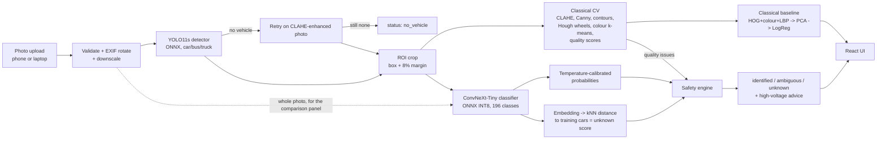

# RescueLens - Design Document

**Team T50 "Clover"** · Computer Vision Hackathon 2026 · Problem statement **P5: Intelligent Fine-Grained Vehicle Recognition and Analysis System**

> All numbers quoted here come from `eval_P5_T50.md` (official Stanford Cars test split, never used for training or tuning).

## 1. Problem

P5 asks for a system that finds a vehicle in a photo and names its make, model and year among 196 visually
similar Stanford Cars classes, combining classical computer vision with deep learning, handling low confidence,
poor lighting, occlusion and unusual viewpoints.

We applied it to a setting where getting this wrong has consequences: **crash response**. Before cutting a trapped
person out of a car, rescuers need the exact model and generation to know where airbags, reinforced steel and,
for hybrids and EVs, high-voltage batteries and cables are. Existing tools (Euro RESCUE / ANCAP RESCUE rescue sheets,
Crash Recovery System, manufacturer QR stickers, the AURA concept) all need the vehicle to be identified **first** -
by number plate, VIN, QR code or manual search. At a crash those can be missing, crushed or unreadable.

**RescueLens identifies the vehicle from how it looks, and - more importantly - says when it is not sure.**

## 2. Goals and non-goals

| Goals | Non-goals |
|---|---|
| Detect the vehicle and draw its bounding box | Number-plate recognition, tracking, traffic events (excluded by P5) |
| Make / model / year with calibrated confidence | Replacing official rescue documentation |
| Classical vs deep vs hybrid comparison, ablation, failure analysis | Recognising cars outside the 196 classes (we detect and flag them instead) |
| Turn uncertainty into a safe action (identified / ambiguous / unknown) | Damage assessment |
| Live web app usable from a phone, answer in seconds | |

## 3. Architecture

| Unit | Code | Does | Depends on |
|---|---|---|---|
| Detector | `backend/app/models.py::Detector` | Letterbox, ONNX inference, NMS, picks the main vehicle | `yolo11s.onnx` |
| Classical CV | `backend/app/classical.py` | Enhancement, edges, contours, wheels, colour, texture, quality, baseline features, step images | OpenCV |
| Classifier | `backend/app/models.py::Classifier` | Preprocess like training, logits + embedding, temperature, unknown score | `classifier_int8.onnx`, `config.json`, `train_emb.npy` |
| Classical baseline | `backend/app/models.py::Baseline` | Numpy re-implementation of the trained scaler -> PCA -> logistic regression | `baseline.npz` |
| Safety engine | `backend/app/safety.py` | Hierarchy (make -> family -> vehicle), 3 result states, summed high-voltage probability, actions | `data/hazards.json` |
| Pipeline / API | `backend/app/pipeline.py`, `main.py` | Orchestration, timing, errors, mock mode, serves UI | all of the above |
| UI | `frontend/` | Upload / camera, result, pipeline steps, stress test, comparison dashboard | `docs/api-contract.md` |
| Training | `training/` | Classifier training + all metrics; detector eval + classical baseline | Stanford Cars |

## 4. Data

* **Stanford Cars**: 16,185 images, 196 classes (make, model, year), one ground-truth box per image.
  8,144 train / 8,041 test.
* **Split**: stratified 90/10 train/validation from the official train set (seed 42). The official test set is used
  once, for the final numbers only.
* **Preprocessing**: crop the ground-truth box + 8% margin (same rule the app uses on detector boxes), resize to 384x384.
* **Augmentation**: random resized crop, horizontal flip, random darkening (night), colour jitter, random erasing
  (occlusion).
* **Known gaps**: newest model year is 2012, US-market cars only, no damaged vehicles. Handled by the unknown check
  and stated as limitations.

## 5. Models and why

| Choice | Why |
|---|---|
| **ConvNeXt-Tiny**, ImageNet-22k pretrained, fine-tuned at 384 px | Strong fine-grained transfer at 28 M parameters; small enough for CPU inference after INT8 |
| **YOLO11s** COCO-pretrained (car/bus/truck) | Stanford images are single-vehicle, so a pretrained detector already localises well; no labelled crash data to fine-tune on |
| **Classical baseline**: HOG + HSV histogram + LBP + aspect ratio -> PCA(256) -> logistic regression | Required comparison; uses exactly the same feature code as the app |
| **Temperature scaling** on validation | Raw softmax is over/under-confident; calibrated probabilities make thresholds meaningful |
| **kNN embedding distance** for unknown cars | Softmax confidence stays high on unseen models (e.g. Indian cars); distance to known cars does not |
| **Dynamic INT8** (MatMul/Gemm) via ONNX Runtime | ~3-4x smaller, faster on the 2-vCPU host; shipped only if it loses < 1 point of accuracy |

## 6. Hybrid integration (where classical CV earns its place)

1. **Localisation**: detector crop vs whole image (ablation: crop vs no crop).
2. **Enhancement**: CLAHE as a detector retry when nothing is found, and in the visual pipeline. We measured CLAHE before the classifier on darkened test photos: it cost 0.3-0.5 points, because training-time darkening already made the network brightness-robust, so it is switched off for classification (an ablation result we kept).
3. **Measurement**: brightness, contrast, sharpness (Laplacian variance), resolution and cut-off checks explain
   *why* a prediction is unreliable ("Low light", "Blurry").
4. **Late fusion**: classical-baseline probabilities fused with deep probabilities, weight chosen on validation - the best weight was 0 (the classical model adds no information the network lacks), reported as-is.
5. **Interpretability**: every classical stage is returned as an image and shown in the UI.

## 7. Low-confidence handling (the safety engine)

* **Hierarchy**: probabilities summed to family (e.g. "Hyundai Sonata") and make, so the system answers at the deepest
  level it is sure of.
* **States**: `identified` (vehicle prob >= 0.6) · `ambiguous` (family or make level) · `unknown`
  (unknown score above threshold or make prob < 0.5).
* **High voltage**: P(hybrid/EV) = sum of the 9 hybrid/EV class probabilities. Warn at >= 0.05 (miss rate 0.9% vs 4.6% for the top-1 label, false alarms 0.7%) - because missing a hybrid
  is far worse than a false alarm. Unknown vehicles are treated as *possibly* high-voltage.
* Thresholds come from the validation set; the threshold table (miss rate vs false alarms) is in the eval file.

## 8. Evaluation

See `eval_P5_T50.md`: top-1/top-5, IoU, mAP@0.5 and @0.5:0.95, model size + latency (FP32 vs INT8),
robustness under darkness / haze / blur / low resolution / occlusion, calibration (ECE), risk-coverage,
high-voltage miss / false-alarm rates, classical vs deep vs hybrid, ablation, most-confused pairs.

## 9. Failure cases (from the test-set confusion counts in `eval_P5_T50.md`)

1. **Same vehicle, different trim**: *Chevrolet Express Cargo Van 2007* taken for *Chevrolet Express Van 2007*
   (14 test photos, the most frequent error). The two differ mainly in rear side windows, often out of frame.
   Cause: the label distinguishes a body option, not a shape. Safety impact: none (same structure, same powertrain).
2. **Same model, different year / generation**: *Dodge Caliber Wagon 2012* taken for the *2007* model (10),
   *Audi V8 Sedan 1994* for *Audi 100 Sedan 1994* (10), *Audi S5 Coupe* for *Audi A5 Coupe* (9).
   Cause: facelifts and performance trims change only grilles, bumpers and badges. Mitigation: the family-level
   answer ("Audi A5/S5 family") is reported when the year cannot be separated.
3. **Rebadged twins**: *Dodge Sprinter Cargo Van 2009* taken for *Mercedes-Benz Sprinter Van 2012* (8) - the same van
   sold under two brands. A badge-level detail the network rarely sees at 384 px.
4. **Degraded photos** (robustness table): strong blur drops top-1 to 44%, a 40 px vehicle to 55%, and hiding 45% of
   the vehicle to 62%. The quality checks flag these photos ("Blurry", "Low resolution") so the low confidence is
   explained rather than hidden.
5. **Same body, different powertrain**: Hyundai Sonata Sedan vs Sonata Hybrid 2012. The summed high-voltage
   probability cuts missed hybrids/EVs from 4.6% (top-1 label) to 0.9%.
6. **Out-of-distribution cars**: on 60 freely licensed Wikimedia Commons photos of 30 models the network never saw
   (Indian models such as Swift, Nexon, Creta, Thar, Innova; post-2012 EVs such as Tesla Model 3/Y, Ioniq 5, ID.4),
   **88.3%** were answered "unknown" while only 5% of known test cars are wrongly flagged. The misses are look-alikes:
   Mahindra Thar taken for Jeep Wrangler (the Thar is styled on it), Tesla Model Y for Tesla Model S - where the
   high-voltage warning still fired - and MG Hector answered "not certain" rather than "unknown".

## 10. Deployment

One Docker image (React build + FastAPI + ONNX Runtime) on Hugging Face Spaces (2 vCPU, 16 GB). GitHub `main` is
mirrored to the Space by a GitHub Action. Model files live in the `rescuelens-models` repo and are fetched at build
time. Inputs are validated (type, 10 MB limit, decompression-bomb guard, EXIF rotation, HEIC); errors return a JSON
error code shown by the UI; without model files the app serves fixture responses instead of crashing.

## 11. Limitations

* Trained on 2012-and-older US-market cars; anything newer is flagged unknown rather than identified.
* No crashed vehicles in the data; robustness is measured with simulated darkness, haze, blur, low resolution and occlusion.
* The rescue layer links official guides for the hybrid/EV classes only; it is a prototype, not certified.

## 12. Ethics and safety

* **Decision support only**: every result carries a disclaimer; the UI never hides uncertainty.
* **Conservative by design**: unknown vehicles and ambiguous hybrids default to "treat as high-voltage".
* **Privacy**: no number plates or faces are read or stored; uploads are processed in memory and not kept.
* **Dual use**: fine-grained vehicle recognition can support surveillance; we deliberately excluded plate reading and
  tracking and scoped the application to rescue.

## 13. Related work

Euro NCAP Euro RESCUE and ANCAP RESCUE (rescue-sheet apps, manual model search / QR), Bliksund Crash Recovery System
(plate/VIN lookup), Mercedes-Benz Rescue Assist (QR), AURA (James Dyson Award 2026 concept: plate recognition + AR),
Motorola Assist (police footage search). None identify the vehicle from its appearance for rescue, or turn
identification uncertainty into a safety decision.

## 14. Team

| Member | USN | Owns |
|---|---|---|
| Priyanshu Kumar Senapati | 1RUA24CSE0337 | Classifier training, calibration, safety metrics |
| Saatwik Kumar Yadav | 1RUA24CSE0390 | (fill in) |
| Rachana Bhaskar Gowda | 1RUA24CSE0348 | (fill in) |
| R Muni Disnitha | 1RUA24CSE0345 | (fill in) |
